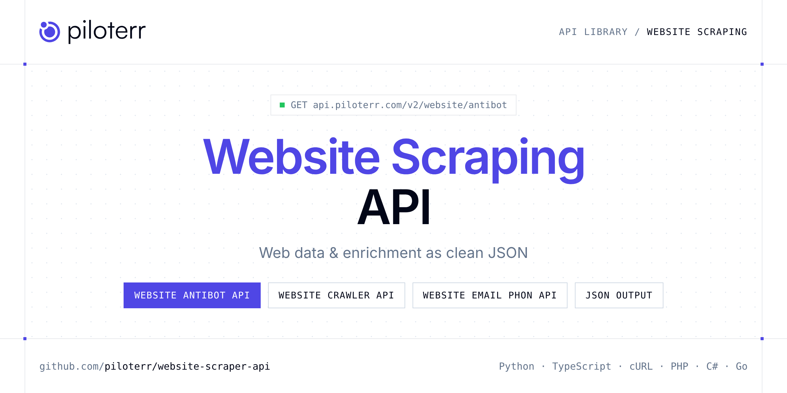

<p align="center">
  <a href="https://www.piloterr.com"></a>
</p>

# Website Scraping API

[](https://discord.gg/CFj3ph8aHU) [](https://app.piloterr.com) [](https://app.piloterr.com/openapi) [](LICENSE)

The **Piloterr Website Scraping API** lets you extract public data from Website Scraping as **clean, structured JSON** — no proxies, headless browsers or HTML parsing to maintain. Endpoints available in production:

- **Website Antibot API** — Detect which anti-bot protection protects a website before you scrape.
- **Website Crawler API** — Fetch public pages with fast HTTP crawling (no JavaScript).
- **Website Email Phone Extractor API** — Extract emails and phone numbers from websites for comprehensive contact details, including social media profiles across 12+ platforms.
- **Website Rendering API** — Render JavaScript-heavy pages in a headless browser and return post-render HTML.
- **Website Screenshot API** — Browser-like Screenshot API that captures webpages as PNG/JPEG/WebP or PDF for previews, QA, reporting, monitoring, and archiving no headless setup.
- **Website Technology API** — Identify the technologies behind any website CMS, frameworks, analytics, CDN, hosting, and more, for competitive market analysis and technological insight.
- **Website WebUnlocker API** — Bypass advanced anti-bot systems (Cloudflare, DataDome, Akamai, PerimeterX) on whitelisted domains.

Use it to render, unlock, crawl or enrich any website or domain without running your own scraping infrastructure.

| Endpoint | Path | Credits | What you get |
|---|---|---|---|
| [Website Antibot API](#website-antibot-api) | `/v2/website/antibot` | 1 | Detect which anti-bot protection protects a website before you scrape. Get the vendor, confidence level, and matching clues from a single URL check. |
| [Website Crawler API](#website-crawler-api) | `/v2/website/crawler` | 1 | Fetch public pages with fast HTTP crawling (no JavaScript). Best first choice for static or server-rendered HTML; use Rendering or WebUnlocker when JS or anti-bot blocks you. |
| [Website Email Phone Extractor API](#website-email-phone-extractor-api) | `/v2/website/email_phone_extractor` | 1 | Extract emails and phone numbers from websites for comprehensive contact details, including social media profiles across 12+ platforms. |
| [Website Rendering API](#website-rendering-api) | `/v2/website/rendering` | 2 | Render JavaScript-heavy pages in a headless browser and return post-render HTML. Use when Crawler returns empty DOM; escalate to WebUnlocker if bot protection blocks the session. |
| [Website Screenshot API](#website-screenshot-api) | `/v2/website/screenshot` | 2 | Browser-like Screenshot API that captures webpages as PNG/JPEG/WebP or PDF for previews, QA, reporting, monitoring, and archiving no headless setup. |
| [Website Technology API](#website-technology-api) | `/v2/website/technology` | 1 | Identify the technologies behind any website CMS, frameworks, analytics, CDN, hosting, and more, for competitive market analysis and technological insight. |
| [Website WebUnlocker API](#website-webunlocker-api) | `/v2/website/webunlocker` | 3 | Bypass advanced anti-bot systems (Cloudflare, DataDome, Akamai, PerimeterX) on whitelisted domains. Combines browser rendering and unlock tooling; use after Crawler and Rendering fail. |

## Table of contents

- [How it works](#how-it-works)
- [Website Antibot API](#website-antibot-api)
- [Website Crawler API](#website-crawler-api)
- [Website Email Phone Extractor API](#website-email-phone-extractor-api)
- [Website Rendering API](#website-rendering-api)
- [Website Screenshot API](#website-screenshot-api)
- [Website Technology API](#website-technology-api)
- [Website WebUnlocker API](#website-webunlocker-api)
- [Code examples in other languages](#code-examples-in-other-languages)
- [Practical use cases](#practical-use-cases)
- [Why Piloterr?](#why-piloterr)
- [FAQ](#faq)
- [Official SDKs](#official-sdks)
- [Related scrapers](#related-scrapers)
- [Support](#support)

## How it works

1. **Create a free Piloterr account** and copy your API key from the [dashboard](https://app.piloterr.com).
2. **Send a `GET` (or `POST`) request** to `https://api.piloterr.com/v2/...` with the header `x-api-key: YOUR_API_KEY`.
3. **Receive structured JSON** — Piloterr handles rendering, proxies, retries and parsing.

```bash
export PILOTERR_API_KEY="your-api-key"
pip install requests        # Python
# TypeScript: Node.js 18+ (native fetch), run with `npx tsx file.ts`
```

> Every endpoint accepts both `GET` (query string) and `POST` (JSON body with the same fields).

## Website Antibot API

Detect which anti-bot protection protects a website before you scrape. Get the vendor, confidence level, and matching clues from a single URL check.

`GET https://api.piloterr.com/v2/website/antibot` · **1 credit per request** · [Full reference](https://app.piloterr.com/openapi)

### Request parameters

| Parameter | Type | Required | Description |
|---|---|---|---|
| `query` | string | ✅ | Full URL or domain name to analyze for anti-bot protection. Must be a valid hostname. |
| `timeout` | number | — | Maximum request timeout in seconds. Defaults to `15`. |

### Python example

```python
import json
import os
import requests

response = requests.get(
    "https://api.piloterr.com/v2/website/antibot",
    headers={"x-api-key": os.environ["PILOTERR_API_KEY"]},
    params={
        "query": "https://www.example.com",
    },
    timeout=120,
)
response.raise_for_status()
data = response.json()

print(json.dumps(data, indent=2, ensure_ascii=False)[:2000])
```

### TypeScript example

```typescript
type WebsiteAntibot = {
  status?: number;
  vendor?: string;
  final_url?: string;
  confidence?: string;
  detections?: {
    vendor?: string;
    evidence?: string[];
    confidence?: string;
  }[];
  requested_url?: string;
};

const params = new URLSearchParams({
  "query": "https://www.example.com",
});

const response = await fetch(`https://api.piloterr.com/v2/website/antibot?${params}`, {
  headers: { "x-api-key": process.env.PILOTERR_API_KEY! },
});
if (!response.ok) throw new Error(`Piloterr error ${response.status}: ${await response.text()}`);

const data = (await response.json()) as WebsiteAntibot;

console.log(JSON.stringify(data, null, 2).slice(0, 2000));
```


### Output example

Example response from the API reference, abridged — real values depend on the page you scrape.

```json
{
  "status": 200,
  "vendor": "cloudflare",
  "final_url": "https://www.crunchbase.com/",
  "confidence": "high",
  "detections": [
    {
      "vendor": "cloudflare",
      "evidence": [
        "Header cf-ray: a1da70864ed39e6f-CDG",
        "Header cf-cache-status: HIT"
      ],
      "confidence": "high"
    }
  ],
  "requested_url": "https://www.crunchbase.com/"
}
```

### Response fields

| Field | Type | Description |
|---|---|---|
| `status` | integer |  |
| `vendor` | string |  |
| `final_url` | string |  |
| `confidence` | string |  |
| `detections[]` | object[] |  |
| `detections[].vendor` | string |  |
| `detections[].evidence` | string[] |  |
| `detections[].confidence` | string |  |
| `requested_url` | string |  |

## Website Crawler API

Fetch public pages with fast HTTP crawling (no JavaScript). Best first choice for static or server-rendered HTML; use Rendering or WebUnlocker when JS or anti-bot blocks you.

`GET | POST https://api.piloterr.com/v2/website/crawler` · **1 credit per request** · [Full reference](https://app.piloterr.com/openapi)

### Request parameters

| Parameter | Type | Required | Description |
|---|---|---|---|
| `query` | string | ✅ | A public website URL to fetch with the Crawler engine (HTTP only, no JavaScript). Must include `http://` or `https://`. |
| `allow_redirects` | boolean | — | Controls whether the crawler should follow HTTP redirects. |
| `return_page_source` | boolean | — | Controls whether the response returns the raw, unprocessed HTML source of the page. |

### Python example

```python
import json
import os
import requests

response = requests.get(
    "https://api.piloterr.com/v2/website/crawler",
    headers={"x-api-key": os.environ["PILOTERR_API_KEY"]},
    params={
        "query": "https://example.com",
    },
    timeout=120,
)
response.raise_for_status()
data = response.json()

print(json.dumps(data, indent=2, ensure_ascii=False)[:2000])
```

### TypeScript example

```typescript
type WebsiteCrawler = string;

const params = new URLSearchParams({
  "query": "https://example.com",
});

const response = await fetch(`https://api.piloterr.com/v2/website/crawler?${params}`, {
  headers: { "x-api-key": process.env.PILOTERR_API_KEY! },
});
if (!response.ok) throw new Error(`Piloterr error ${response.status}: ${await response.text()}`);

const data = (await response.json()) as WebsiteCrawler;

console.log(JSON.stringify(data, null, 2).slice(0, 2000));
```

<details>
<summary><b>POST variant</b></summary>

```http
POST https://api.piloterr.com/v2/website/crawler
x-api-key: YOUR_API_KEY
Content-Type: application/json

{"query": "https://example.com"}
```
</details>

### Output example

Example response from the API reference, abridged — real values depend on the page you scrape.

```json
"<!doctype html><html lang=\"en\"><head><title>Example Domain</title><meta name=\"viewport\" content=\"width=device-width, initial-scale=1\"><st…"
```

### Response fields

| Field | Type | Description |
|---|---|---|

## Website Email Phone Extractor API

Extract emails and phone numbers from websites for comprehensive contact details, including social media profiles across 12+ platforms.

`GET | POST https://api.piloterr.com/v2/website/email_phone_extractor` · **1 credit per request** · [Full reference](https://app.piloterr.com/openapi)

### Request parameters

| Parameter | Type | Required | Description |
|---|---|---|---|
| `query` | string | ✅ | A website URL to crawl for contact information. Must include the `http://` or `https://` protocol. The crawler will follow internal links ("a" anchors) to find contact details across the site. |
| `country_code` | string | — | An ISO 3166-1 alpha-2 country code used to improve the accuracy of phone number validation and parsing. |

### Python example

```python
import json
import os
import requests

response = requests.get(
    "https://api.piloterr.com/v2/website/email_phone_extractor",
    headers={"x-api-key": os.environ["PILOTERR_API_KEY"]},
    params={
        "query": "https://www.hexa.cc",
    },
    timeout=120,
)
response.raise_for_status()
data = response.json()

print(json.dumps(data, indent=2, ensure_ascii=False)[:2000])
```

### TypeScript example

```typescript
type WebsiteEmailPhoneExtractor = {
  emails?: string[];
  contact_pages?: unknown[];
  phone_numbers?: unknown[];
  reddit_profiles?: unknown[];
  tiktok_profiles?: unknown[];
  twitter_profiles?: string[];
  youtube_channels?: unknown[];
  facebook_profiles?: unknown[];
  linkedin_profiles?: string[];
  snapchat_profiles?: unknown[];
  telegram_channels?: unknown[];
  instagram_profiles?: string[];
  pinterest_profiles?: unknown[];
  crunchbase_profiles?: unknown[];
};

const params = new URLSearchParams({
  "query": "https://www.hexa.cc",
});

const response = await fetch(`https://api.piloterr.com/v2/website/email_phone_extractor?${params}`, {
  headers: { "x-api-key": process.env.PILOTERR_API_KEY! },
});
if (!response.ok) throw new Error(`Piloterr error ${response.status}: ${await response.text()}`);

const data = (await response.json()) as WebsiteEmailPhoneExtractor;

console.log(JSON.stringify(data, null, 2).slice(0, 2000));
```

<details>
<summary><b>POST variant</b></summary>

```http
POST https://api.piloterr.com/v2/website/email_phone_extractor
x-api-key: YOUR_API_KEY
Content-Type: application/json

{"query": "https://www.hexa.cc"}
```
</details>

### Output example

Example response from the API reference, abridged — real values depend on the page you scrape.

```json
{
  "emails": [
    "love@hexa.com"
  ],
  "contact_pages": [],
  "phone_numbers": [],
  "reddit_profiles": [],
  "tiktok_profiles": [],
  "twitter_profiles": [
    "https://x.com/joinhexa"
  ],
  "youtube_channels": [],
  "facebook_profiles": [],
  "linkedin_profiles": [
    "https://www.linkedin.com/company/joinhexa/"
  ],
  "snapchat_profiles": [],
  "telegram_channels": [],
  "instagram_profiles": [
    "https://www.instagram.com/joinhexa/"
  ],
  "pinterest_profiles": [],
  "crunchbase_profiles": []
}
```

### Response fields

| Field | Type | Description |
|---|---|---|
| `emails` | string[] |  |
| `contact_pages` | any[] |  |
| `phone_numbers` | any[] |  |
| `reddit_profiles` | any[] |  |
| `tiktok_profiles` | any[] |  |
| `twitter_profiles` | string[] |  |
| `youtube_channels` | any[] |  |
| `facebook_profiles` | any[] |  |
| `linkedin_profiles` | string[] |  |
| `snapchat_profiles` | any[] |  |
| `telegram_channels` | any[] |  |
| `instagram_profiles` | string[] |  |
| `pinterest_profiles` | any[] |  |
| `crunchbase_profiles` | any[] |  |

## Website Rendering API

Render JavaScript-heavy pages in a headless browser and return post-render HTML. Use when Crawler returns empty DOM; escalate to WebUnlocker if bot protection blocks the session.

`GET | POST https://api.piloterr.com/v2/website/rendering` · **2 credits per request** · [Full reference](https://app.piloterr.com/openapi)

### Request parameters

| Parameter | Type | Required | Description |
|---|---|---|---|
| `query` | string | ✅ | A public website URL to render in a headless browser. Must include `http://` or `https://`. |
| `wait_in_seconds` | number | — | Number of seconds to wait after page load before returning the rendered HTML. Useful for pages with delayed rendering or animations. |
| `wait_for` | string | — | A CSS or XPath selector to wait for before returning the rendered HTML. The headless browser will hold the response until the specified element appears in the DOM. |
| `block_ads` | boolean | — | Controls whether the headless browser should block ad requests during rendering. |
| `timeout` | number | — | Maximum number of seconds to wait for the page to fully load before returning whatever has been rendered so far. |

### Python example

```python
import json
import os
import requests

response = requests.get(
    "https://api.piloterr.com/v2/website/rendering",
    headers={"x-api-key": os.environ["PILOTERR_API_KEY"]},
    params={
        "query": "https://example.com",
    },
    timeout=120,
)
response.raise_for_status()
data = response.json()

print(json.dumps(data, indent=2, ensure_ascii=False)[:2000])
```

### TypeScript example

```typescript
type WebsiteRendering = string;

const params = new URLSearchParams({
  "query": "https://example.com",
});

const response = await fetch(`https://api.piloterr.com/v2/website/rendering?${params}`, {
  headers: { "x-api-key": process.env.PILOTERR_API_KEY! },
});
if (!response.ok) throw new Error(`Piloterr error ${response.status}: ${await response.text()}`);

const data = (await response.json()) as WebsiteRendering;

console.log(JSON.stringify(data, null, 2).slice(0, 2000));
```

<details>
<summary><b>POST variant</b></summary>

```http
POST https://api.piloterr.com/v2/website/rendering
x-api-key: YOUR_API_KEY
Content-Type: application/json

{"query": "https://example.com"}
```
</details>

### Output example

Example response from the API reference, abridged — real values depend on the page you scrape.

```json
"<!DOCTYPE html><html lang=\"en\"><head><title>Example Domain</title><meta name=\"viewport\" content=\"width=device-width, initial-scale=1\"><st…"
```

### Response fields

| Field | Type | Description |
|---|---|---|

## Website Screenshot API

Browser-like Screenshot API that captures webpages as PNG/JPEG/WebP or PDF for previews, QA, reporting, monitoring, and archiving no headless setup.

`GET | POST https://api.piloterr.com/v2/website/screenshot` · **2 credits per request** · [Full reference](https://app.piloterr.com/openapi)

### Request parameters

| Parameter | Type | Required | Description |
|---|---|---|---|
| `url` | string | ✅ | The URL of the webpage to capture. Examples: ``` https://www.amazon.com/s?k=pokemon ``` |
| `format` | string (`jpeg`, `jpg`, `pdf`, `png`, `webp`) | — | The output format of the screenshot. |
| `device` | string (`galaxy_fold4`, `galaxy_s23`, `galaxy_s23_ultra`, `galaxy_s8`, `huawei_mate_50_pro`, `huawei_p60_pro`) | — | The device type to emulate for the screenshot. |
| `full_page` | boolean | — | Capture the entire page instead of just the visible viewport. |
| `full_page_scroll` | boolean | — | Scroll the page to fully load lazy-loaded elements before capturing a full-page screenshot. |
| `full_page_scroll_duration` | number | — | Time in milliseconds for scrolling before capturing the full page. |
| `viewport_width` | number | — | The width of the browser viewport in pixels. |
| `viewport_height` | number | — | The height of the browser viewport in pixels. |
| `scale_factor` | number | — | The scale factor for high-resolution screenshots. |
| `image_quality` | string | — | Generate images with custom quality settings. |
| `selector` | string | — | Capture a specific element on the page instead of the full viewport. |
| `cache` | boolean | — | Cache the response. |
| `cache_ttl` | number | — | Cache the response for a custom TTL (in seconds). |
| `remove_selectors` | string | — | A comma-separated list of elements to hide before capturing (e.g., ads, popups). |
| `remove_cookie_banners` | boolean | — | Automatically remove cookie banners before capturing. |
| `remove_ads` | boolean | — | Automatically remove ads before capturing. |
| `block_resources` | string (`document`, `eventsource`, `fetch`, `font`, `image`, `manifest`) | — | Comma-separated list of resource types to block (e.g., “image,stylesheet,font”). |
| `block_urls` | string | — | Comma-separated list of URL patterns to block (e.g., “analytics,tracking,advertisement”). |
| `delay` | number | — | Delay in seconds before capturing the screenshot. |
| `wait_until` | array (`domcontentloaded`, `load`, `networkidle0`, `networkidle2`) | — | Define when to capture. |
| `wait_for_selector` | string | — | Wait for a specific element to appear before taking the screenshot. |
| `proxy` | string | — | Specify a proxy server to route your request through. |
| `s3_secret_key` | string | — | AWS S3 secret access key. |
| `s3_access_key_id` | string | — | AWS S3 access key ID. |
| `s3_bucket` | string | — | The S3 bucket name where the screenshot will be uploaded. |
| `s3_object_key` | string | — | The filename for the S3 object (auto-generated if not provided). |
| `s3_region` | string | — | AWS S3 region for storage. |
| `storage_endpoint` | string | — | Leave this field empty for AWS S3. Only specify a value if required. S3-compatible storage services are supported, for example, use https://<accountId>.r2.cloudflarestorage.com for Cloudflare R2. |
| `s3_url` | boolean | — | Use S3 storage for screenshots. The S3 URL will be returned in the response. |

### Python example

```python
import json
import os
import requests

response = requests.get(
    "https://api.piloterr.com/v2/website/screenshot",
    headers={"x-api-key": os.environ["PILOTERR_API_KEY"]},
    params={
        "url": "https://www.amazon.com/s?k=pokemon",
    },
    timeout=120,
)
response.raise_for_status()
data = response.json()

print(json.dumps(data, indent=2, ensure_ascii=False)[:2000])
```

### TypeScript example

```typescript
type WebsiteScreenshot = Record<string, unknown>;

const params = new URLSearchParams({
  "url": "https://www.amazon.com/s?k=pokemon",
});

const response = await fetch(`https://api.piloterr.com/v2/website/screenshot?${params}`, {
  headers: { "x-api-key": process.env.PILOTERR_API_KEY! },
});
if (!response.ok) throw new Error(`Piloterr error ${response.status}: ${await response.text()}`);

const data = (await response.json()) as WebsiteScreenshot;

console.log(JSON.stringify(data, null, 2).slice(0, 2000));
```

<details>
<summary><b>POST variant</b></summary>

```http
POST https://api.piloterr.com/v2/website/screenshot
x-api-key: YOUR_API_KEY
Content-Type: application/json

{"url": "https://www.amazon.com/s?k=pokemon"}
```
</details>

### Output example

Response shape with placeholder values — field names follow the API reference.

```json
"example"
```

### Response fields

| Field | Type | Description |
|---|---|---|

## Website Technology API

Identify the technologies behind any website CMS, frameworks, analytics, CDN, hosting, and more, for competitive market analysis and technological insight.

`GET | POST https://api.piloterr.com/v2/website/technology` · **1 credit per request** · [Full reference](https://app.piloterr.com/openapi)

### Request parameters

| Parameter | Type | Required | Description |
|---|---|---|---|
| `query` | string | ✅ | A website URL to analyze for technology stack detection. Must include the `http://` or `https://` protocol. |
| `mode` | string | — | Controls the level of detail returned in the technology detection response. |

### Python example

```python
import json
import os
import requests

response = requests.get(
    "https://api.piloterr.com/v2/website/technology",
    headers={"x-api-key": os.environ["PILOTERR_API_KEY"]},
    params={
        "query": "https://example.com",
    },
    timeout=120,
)
response.raise_for_status()
data = response.json()

print(json.dumps(data, indent=2, ensure_ascii=False)[:2000])
```

### TypeScript example

```typescript
type WebsiteTechnology = {
  cms?: string;
  urls?: {
    "https://piloterr.com/"?: {
      status?: number;
    };
    "https://www.piloterr.com/"?: {
      status?: number;
    };
  };
  technologies?: string[];
};

const params = new URLSearchParams({
  "query": "https://example.com",
});

const response = await fetch(`https://api.piloterr.com/v2/website/technology?${params}`, {
  headers: { "x-api-key": process.env.PILOTERR_API_KEY! },
});
if (!response.ok) throw new Error(`Piloterr error ${response.status}: ${await response.text()}`);

const data = (await response.json()) as WebsiteTechnology;

console.log(JSON.stringify(data, null, 2).slice(0, 2000));
```

<details>
<summary><b>POST variant</b></summary>

```http
POST https://api.piloterr.com/v2/website/technology
x-api-key: YOUR_API_KEY
Content-Type: application/json

{"query": "https://example.com"}
```
</details>

### Output example

Example response from the API reference, abridged — real values depend on the page you scrape.

```json
{
  "cms": "Webflow",
  "urls": {
    "https://piloterr.com/": {
      "status": 301
    },
    "https://www.piloterr.com/": {
      "status": 200
    }
  },
  "technologies": [
    "Webflow",
    "jsDelivr"
  ]
}
```

### Response fields

| Field | Type | Description |
|---|---|---|
| `cms` | string |  |
| `urls` | object |  |
| `urls.https://piloterr.com/` | object |  |
| `urls.https://www.piloterr.com/` | object |  |
| `technologies` | string[] |  |

## Website WebUnlocker API

Bypass advanced anti-bot systems (Cloudflare, DataDome, Akamai, PerimeterX) on whitelisted domains. Combines browser rendering and unlock tooling; use after Crawler and Rendering fail.

`GET | POST https://api.piloterr.com/v2/website/webunlocker` · **3 credits per request** · [Full reference](https://app.piloterr.com/openapi)

### Request parameters

| Parameter | Type | Required | Description |
|---|---|---|---|
| `query` | string | ✅ | A public website URL to unlock with the WebUnlocker engine. Must include `http://` or `https://`. The target domain must be on Piloterr's approved whitelist. |
| `allow_redirects` | boolean | — | Controls whether the WebUnlocker engine should follow HTTP redirects. |
| `return_page_source` | boolean | — | Controls whether the response returns the raw, unprocessed HTML source of the page. |

### Python example

```python
import json
import os
import requests

response = requests.get(
    "https://api.piloterr.com/v2/website/webunlocker",
    headers={"x-api-key": os.environ["PILOTERR_API_KEY"]},
    params={
        "query": "https://www.norauto.fr/t/pneu/w-185-h-55-r-14/ete-s/80-l-h-q.html",
    },
    timeout=120,
)
response.raise_for_status()
data = response.json()

print(json.dumps(data, indent=2, ensure_ascii=False)[:2000])
```

### TypeScript example

```typescript
type WebsiteWebunlocker = string;

const params = new URLSearchParams({
  "query": "https://www.norauto.fr/t/pneu/w-185-h-55-r-14/ete-s/80-l-h-q.html",
});

const response = await fetch(`https://api.piloterr.com/v2/website/webunlocker?${params}`, {
  headers: { "x-api-key": process.env.PILOTERR_API_KEY! },
});
if (!response.ok) throw new Error(`Piloterr error ${response.status}: ${await response.text()}`);

const data = (await response.json()) as WebsiteWebunlocker;

console.log(JSON.stringify(data, null, 2).slice(0, 2000));
```

<details>
<summary><b>POST variant</b></summary>

```http
POST https://api.piloterr.com/v2/website/webunlocker
x-api-key: YOUR_API_KEY
Content-Type: application/json

{"query": "https://www.norauto.fr/t/pneu/w-185-h-55-r-14/ete-s/80-l-h-q.html"}
```
</details>

### Output example

Example response from the API reference, abridged — real values depend on the page you scrape.

```json
"<!DOCTYPE html><html lang=\"fr\"><head><meta charset=\"UTF-8\"><title>Pneus été 185/55 R14 | Norauto</title><meta name=\"viewport\" content=\"wi…"
```

### Response fields

| Field | Type | Description |
|---|---|---|

## Code examples in other languages

Ready-to-run examples live in the [`examples/`](examples) folder. Each one reads your key from the `PILOTERR_API_KEY` environment variable.

| Language | Website Antibot | Website Crawler | Website Email Phone Extractor | Website Rendering | Website Screenshot | Website Technology | Website WebUnlocker |
|---|---|---|---|---|---|---|---|
| cURL (Bash) | [`antibot`](examples/curl/antibot.sh) | [`crawler`](examples/curl/crawler.sh) | [`email-phone-extractor`](examples/curl/email_phone_extractor.sh) | [`rendering`](examples/curl/rendering.sh) | [`screenshot`](examples/curl/screenshot.sh) | [`technology`](examples/curl/technology.sh) | [`webunlocker`](examples/curl/webunlocker.sh) |
| PHP | [`antibot`](examples/php/antibot.php) | [`crawler`](examples/php/crawler.php) | [`email-phone-extractor`](examples/php/email_phone_extractor.php) | [`rendering`](examples/php/rendering.php) | [`screenshot`](examples/php/screenshot.php) | [`technology`](examples/php/technology.php) | [`webunlocker`](examples/php/webunlocker.php) |
| C# | [`antibot`](examples/csharp/Antibot.cs) | [`crawler`](examples/csharp/Crawler.cs) | [`email-phone-extractor`](examples/csharp/EmailPhoneExtractor.cs) | [`rendering`](examples/csharp/Rendering.cs) | [`screenshot`](examples/csharp/Screenshot.cs) | [`technology`](examples/csharp/Technology.cs) | [`webunlocker`](examples/csharp/Webunlocker.cs) |
| Go | [`antibot`](examples/go/antibot.go) | [`crawler`](examples/go/crawler.go) | [`email-phone-extractor`](examples/go/email_phone_extractor.go) | [`rendering`](examples/go/rendering.go) | [`screenshot`](examples/go/screenshot.go) | [`technology`](examples/go/technology.go) | [`webunlocker`](examples/go/webunlocker.go) |
| Java | [`antibot`](examples/java/AntibotExample.java) | [`crawler`](examples/java/CrawlerExample.java) | [`email-phone-extractor`](examples/java/EmailPhoneExtractorExample.java) | [`rendering`](examples/java/RenderingExample.java) | [`screenshot`](examples/java/ScreenshotExample.java) | [`technology`](examples/java/TechnologyExample.java) | [`webunlocker`](examples/java/WebunlockerExample.java) |
| Ruby | [`antibot`](examples/ruby/antibot.rb) | [`crawler`](examples/ruby/crawler.rb) | [`email-phone-extractor`](examples/ruby/email_phone_extractor.rb) | [`rendering`](examples/ruby/rendering.rb) | [`screenshot`](examples/ruby/screenshot.rb) | [`technology`](examples/ruby/technology.rb) | [`webunlocker`](examples/ruby/webunlocker.rb) |
| Node.js | [`antibot`](examples/nodejs/antibot.mjs) | [`crawler`](examples/nodejs/crawler.mjs) | [`email-phone-extractor`](examples/nodejs/email_phone_extractor.mjs) | [`rendering`](examples/nodejs/rendering.mjs) | [`screenshot`](examples/nodejs/screenshot.mjs) | [`technology`](examples/nodejs/technology.mjs) | [`webunlocker`](examples/nodejs/webunlocker.mjs) |

## Practical use cases

- **Scraping any website** — Render JavaScript and unlock protected pages through one API.
- **Data enrichment** — Enrich domains, emails and companies in your pipelines.
- **Security & compliance** — Check domains against blocklists and threat sources.
- **Lead qualification** — Verify contacts and detect website technologies.
- **Automation** — Plug results into ETL, no-code tools and AI agents.

## Why Piloterr?

- **No infrastructure** — no proxies, headless browsers or CAPTCHA solving to run yourself.
- **Structured JSON** — stable, documented fields instead of brittle HTML selectors.
- **Pay per request** — transparent credit cost per endpoint, failed requests are retried for you.
- **One API key, hundreds of sources** — Website Scraping plus many other e-commerce, search and company data endpoints in the [Piloterr library](https://www.piloterr.com/library).
- **Any language** — plain HTTPS + JSON, with examples for Python, TypeScript, cURL, PHP, C#, Go, Java, Ruby and Node.js.

## FAQ

### Is it legal to scrape Website Scraping?

Collecting publicly available data is generally allowed in many jurisdictions, but rules depend on your country, the data you collect and how you use it. Avoid personal data unless you have a lawful basis, respect the website's terms where they apply, and get legal advice for your specific use case. This is not legal advice.

### Do I need proxies or a headless browser?

No. Piloterr handles rendering, proxy rotation and retries on its side. You only send an HTTPS request with your `x-api-key` header and receive JSON.

### How much does a request cost?

Credits per call: `/v2/website/antibot` **1**, `/v2/website/crawler` **1**, `/v2/website/email_phone_extractor` **1**, `/v2/website/rendering` **2**, `/v2/website/screenshot` **2**, `/v2/website/technology` **1**, `/v2/website/webunlocker` **3**. See the [Piloterr website](https://www.piloterr.com) for plans.

### What data does the Website Scraping API return?

Each endpoint returns structured JSON: **Website Antibot** — `status`, `vendor`, `final_url`, `confidence`, `detections[]`, `detections[].vendor`; **Website Crawler** — see the reference; **Website Email Phone Extractor** — `emails`, `contact_pages`, `phone_numbers`, `reddit_profiles`, `tiktok_profiles`, `twitter_profiles`; **Website Rendering** — see the reference.

### Can I get the raw HTML instead of JSON?

Yes. Set `return_page_source=true` and the response becomes `{"result": "..."}` with the page source.

### Which languages are supported?

Any language that can make an HTTP request. This README shows Python and TypeScript; the [`examples/`](examples) folder contains cURL, PHP, C#, Go, Java, Ruby and Node.js.

## Official SDKs

Use Piloterr from your own language with a typed client:

| SDK | Package | Install |
| --- | --- | --- |
| Node.js | [`@piloterr/sdk`](https://www.npmjs.com/package/@piloterr/sdk) | `npm install @piloterr/sdk` |
| Python | [`piloterr`](https://pypi.org/project/piloterr/) | `pip install piloterr` |
| Go | [`piloterr-go`](https://pkg.go.dev/github.com/piloterr/piloterr-go) | `go get github.com/piloterr/piloterr-go` |
| .NET | [`Piloterr`](https://www.nuget.org/packages/Piloterr) | `dotnet add package Piloterr` |
| Ruby | [`piloterr`](https://rubygems.org/gems/piloterr) | `gem install piloterr` |
| PHP | [`piloterr/sdk`](https://packagist.org/packages/piloterr/sdk) | `composer require piloterr/sdk` |
| Java | [`piloterr-java`](https://github.com/piloterr/piloterr-java) | build from source, see its README |
| CLI | [`@piloterr/cli`](https://www.npmjs.com/package/@piloterr/cli) | `npm install -g @piloterr/cli` |
| MCP server | [`@piloterr/mcp`](https://www.npmjs.com/package/@piloterr/mcp) | `npx -y @piloterr/mcp` |

## Related scrapers

- [Domain Intelligence API](https://github.com/piloterr/domain-lookup-api)
- [Email Finder & Verifier API](https://github.com/piloterr/email-finder-api)
- [All Piloterr scrapers on GitHub](https://github.com/piloterr)

## Support

- 💬 Join the [Piloterr Discord](https://discord.gg/CFj3ph8aHU) to ask questions and share what you build.
- 📚 Browse the [API reference (OpenAPI)](https://app.piloterr.com/openapi) and the [Piloterr library](https://www.piloterr.com/library).
- 🔑 [Get your API key](https://app.piloterr.com).

---

<p align="center">
  <a href="https://www.piloterr.com">
    <picture>
      <source media="(prefers-color-scheme: dark)" srcset="images/logo-dark.svg">
      
    </picture>
  </a>
  <br>
  <sub>Built by <a href="https://www.piloterr.com">Piloterr</a> — web scraping APIs for e-commerce, search, real estate and more, one API key.</sub>
</p>

<sub>Website Scraping is a trademark of its respective owner. This repository is not affiliated with or endorsed by Website Scraping. Examples are released under the MIT license.</sub>
